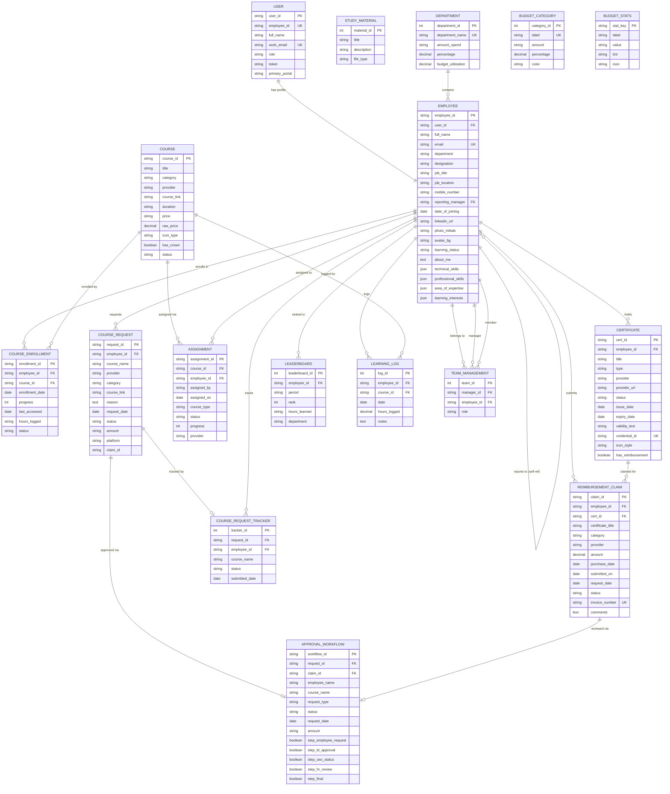

# LMS Frontend — ER Diagram

> **Source**: Derived from all pages & components in `e:\newLMS\LMS\frontend\src\`  
> **Method**: Extracted from JSX state, props, mock data schemas, and API request shapes  
> **Notation**: `PK` = Primary Key · `FK` = Foreign Key · `UK` = Unique Key · `1:1` = One-to-One · `1:N` = One-to-Many  
> **Visual SVG**: A high-resolution standalone SVG diagram is also available: [LMS_ER_Diagram.svg](./LMS_ER_Diagram.svg)

---

## Visual ER Diagram (Mermaid)

```mermaid
%%{init: {
  'theme': 'base',
  'themeVariables': {
    'primaryColor': '#ffffff',
    'primaryTextColor': '#0f172a',
    'primaryBorderColor': '#3b82f6',
    'lineColor': '#2563eb',
    'secondaryColor': '#f1f5f9',
    'tertiaryColor': '#ffffff',
    'fontFamily': 'ui-sans-serif, system-ui, -apple-system, BlinkMacSystemFont, "Segoe UI", Roboto, sans-serif',
    'fontSize': '12px'
  }
}}%%
erDiagram

    %% ============================================================
    %% 1. AUTHENTICATION & USER IDENTITY
    %% ============================================================

    USER {
        string user_id PK "UUID login identifier"
        string employee_id UK "Links to employee record"
        string full_name "User display name"
        string work_email UK "Corporate login email"
        string role "employee | reporting-manager | ld | hr | ceo"
        string token "JWT session token"
        string primary_portal "Default portal route"
    }

    %% ============================================================
    %% 2. EMPLOYEE PROFILE & ORGANIZATION
    %% ============================================================

    EMPLOYEE {
        string employee_id PK "Corporate employee code"
        string user_id FK "References USER.user_id"
        string full_name "Full name from profile"
        string email UK "Official email address"
        string department FK "Department name / code"
        string designation "Job position / role"
        string job_title "Official designation title"
        string job_location "Office branch / site"
        string mobile_number "Contact number"
        string reporting_manager FK "Reports to EMPLOYEE.employee_id"
        date date_of_joining "Onboarding date"
        string linkedin_url "Profile link"
        string photo_initials "Initials fallback"
        string avatar_url "CDN avatar link"
        string avatar_bg "Color theme code"
        string learning_status "Active | Inactive | On Leave"
        text about_me "Bio & executive summary"
        json technical_skills "Tech stack skill tags"
        json professional_skills "Soft skills & leadership"
        json area_of_expertise "Domain expertise"
        json learning_interests "Selected learning topics"
    }

    DEPARTMENT {
        string department_id PK "Department identifier"
        string department_name UK "e.g. Engineering, Sales, HR"
        decimal amount_spend "Total training expenditure"
        decimal percentage "Share of total LMS budget"
        string budget_utilization "High | Normal | Under"
    }

    %% ============================================================
    %% 3. COURSE LIBRARY & MATERIALS
    %% ============================================================

    COURSE {
        string course_id PK "e.g. CAC-2026-001"
        string title "Course headline"
        string category "Domain e.g. Technical, Management"
        string provider "Coursera, Udemy, Internal"
        string course_link "Direct launch URL"
        string duration "e.g. 14 Hours"
        string price "Display price formatted"
        decimal raw_price "Numeric cost in currency"
        string icon_type "Brand icon reference"
        boolean has_crown "Featured / premium badge"
        string status "Available | In-Progress | Retired"
    }

    STUDY_MATERIAL {
        int material_id PK "Auto-increment ID"
        string course_id FK "Associated course"
        string title "Document or guide name"
        string description "Summary overview"
        string file_type "PDF | DOCX | MP4 | ZIP"
    }

    %% ============================================================
    %% 4. LEARNING RECORDS & PROGRESS
    %% ============================================================

    COURSE_ENROLLMENT {
        string enrollment_id PK "Enrollment tracking ID"
        string employee_id FK "Enrolled employee"
        string course_id FK "Target course"
        date enrollment_date "Date commenced"
        int progress "Completion percentage 0-100"
        date last_accessed "Last activity date"
        string hours_logged "Total learning hours logged"
        string status "On track | Low Progress | Completed"
    }

    ASSIGNMENT {
        string assignment_id PK "Assignment batch ID"
        string course_id FK "Assigned course"
        string employee_id FK "Assigned learner"
        string assigned_by "Assigner manager / LD email"
        date assigned_on "Assignment timestamp"
        string course_type "Mandatory | Elective | Compliance"
        string status "Pending | In-Progress | Completed"
        int progress "Progress percentage"
    }

    LEARNING_LOG {
        int log_id PK "Daily log record ID"
        string employee_id FK "Logging employee"
        string course_id FK "Course studied"
        date date "Date of study session"
        decimal hours_logged "Hours spent"
        text notes "Learner study notes"
    }

    LEADERBOARD {
        int leaderboard_id PK "Ranking entry ID"
        string employee_id FK "Ranked employee"
        string period "All-time | Monthly | Weekly"
        int rank "Current rank position"
        string hours_learned "Total hours in period"
        string department "Department ranking category"
    }

    %% ============================================================
    %% 5. REQUESTS, APPROVALS & WORKFLOW
    %% ============================================================

    COURSE_REQUEST {
        string request_id PK "Request tracking code"
        string employee_id FK "Requesting employee"
        string course_name "Requested course title"
        string provider "External platform / vendor"
        string category "Course category"
        text reason "Justification / business case"
        date request_date "Date submitted"
        string status "Pending | Approved | Rejected"
        string amount "Course cost"
        string platform "Platform name"
        string claim_id FK "Optional linked reimbursement"
    }

    COURSE_REQUEST_TRACKER {
        int tracker_id PK "Audit trail log ID"
        string request_id FK "Parent request"
        string employee_id FK "Employee"
        string course_name "Course title"
        string status "Current stage status"
        date submitted_date "Step timestamp"
    }

    APPROVAL_WORKFLOW {
        string workflow_id PK "Workflow instance UUID"
        string request_id FK "Associated course request"
        string claim_id FK "Associated reimbursement"
        string employee_name "Applicant name"
        string course_name "Course / certification title"
        string request_type "CourseRequest | Reimbursement"
        string status "Pending | Approved | Rejected"
        date request_date "Submission date"
        string amount "Monetary value"
        boolean step_employee_request "Step 1: Submitted"
        boolean step_ld_approval "Step 2: L&D Verified"
        boolean step_ceo_status "Step 3: Executive Approved"
        boolean step_hr_review "Step 4: HR Processed"
        boolean step_final "Step 5: Finalized"
    }

    %% ============================================================
    %% 6. CERTIFICATIONS & REIMBURSEMENTS
    %% ============================================================

    CERTIFICATE {
        string cert_id PK "Certificate record ID"
        string employee_id FK "Certificate holder"
        string title "Certificate name"
        string type "Technical | Leadership | Professional"
        string provider "Issuing authority"
        string provider_url "Verification portal link"
        string status "Active | Expired | Under Review"
        date issue_date "Date achieved"
        date expiry_date "Validity expiration date"
        string validity_text "e.g. Valid until Dec 2027"
        string credential_id UK "Unique external license #"
        string icon_style "Badge styling theme"
        boolean has_reimbursement "Claim submitted flag"
    }

    REIMBURSEMENT_CLAIM {
        string claim_id PK "Claim ticket ID"
        string employee_id FK "Claimant employee"
        string cert_id FK "Associated certificate"
        string certificate_title "Certification name"
        string category "Training category"
        string provider "Vendor paid"
        decimal amount "Claim amount in INR/USD"
        date purchase_date "Invoice date"
        date submitted_on "Submission date"
        date request_date "Initiation date"
        string status "Draft | Submitted | Approved | Paid"
        string invoice_number UK "Receipt / Tax invoice number"
        text comments "Approver / finance notes"
    }

    %% ============================================================
    %% 7. BUDGET & TEAM MANAGEMENT
    %% ============================================================

    BUDGET_STATS {
        string stat_key PK "e.g. total_budget, utilized"
        string label "Display stat title"
        string value "Formatted value e.g. $120,000"
        string tint "UI tint color"
        string icon "Icon identifier"
    }

    BUDGET_CATEGORY {
        int category_id PK "Budget line item ID"
        string department_id FK "Allocated department"
        string label UK "e.g. Cloud Certification, Seminars"
        string amount "Allocated sum"
        decimal percentage "Percentage share"
        string color "Chart display color"
    }

    TEAM_MANAGEMENT {
        int team_id PK "Team assignment ID"
        string manager_id FK "Manager EMPLOYEE.employee_id"
        string employee_id FK "Team member EMPLOYEE.employee_id"
        string role "Lead | Senior | Associate"
    }

    %% ============================================================
    %% RELATIONSHIPS & CARDINALITY
    %% ============================================================

    %% Authentication & Hierarchy
    USER ||--|| EMPLOYEE : "1:1 user profile"
    EMPLOYEE ||--o{ EMPLOYEE : "1:N reports to (self-ref)"
    DEPARTMENT ||--o{ EMPLOYEE : "1:N employs"

    %% Courses & Learning Progress
    EMPLOYEE ||--o{ COURSE_ENROLLMENT : "1:N enrolls in"
    COURSE ||--o{ COURSE_ENROLLMENT : "1:N enrolled by"
    COURSE ||--o{ STUDY_MATERIAL : "1:N provides"
    COURSE ||--o{ ASSIGNMENT : "1:N assigned via"
    EMPLOYEE ||--o{ ASSIGNMENT : "1:N assigned to"
    EMPLOYEE ||--o{ LEARNING_LOG : "1:N logs hours"
    COURSE ||--o{ LEARNING_LOG : "1:N logged against"
    EMPLOYEE ||--o{ LEADERBOARD : "1:N ranked in"

    %% Certifications & Reimbursements
    EMPLOYEE ||--o{ CERTIFICATE : "1:N achieves"
    EMPLOYEE ||--o{ REIMBURSEMENT_CLAIM : "1:N submits claim"
    CERTIFICATE ||--o{ REIMBURSEMENT_CLAIM : "1:N claimed under"

    %% Approvals Pipeline
    EMPLOYEE ||--o{ COURSE_REQUEST : "1:N requests"
    COURSE_REQUEST ||--|| APPROVAL_WORKFLOW : "1:1 routed to"
    REIMBURSEMENT_CLAIM ||--|| APPROVAL_WORKFLOW : "1:1 approval queue"
    COURSE_REQUEST ||--|| COURSE_REQUEST_TRACKER : "1:1 tracks status"
    EMPLOYEE ||--o{ COURSE_REQUEST_TRACKER : "1:N audit logs"

    %% Organization & Budget
    DEPARTMENT ||--o{ BUDGET_CATEGORY : "1:N allocates"
    DEPARTMENT ||--o{ BUDGET_STATS : "1:N summarized by"
    EMPLOYEE ||--o{ TEAM_MANAGEMENT : "1:N manager of"
    EMPLOYEE ||--o{ TEAM_MANAGEMENT : "1:N member of"
```

---

## Entity Tables

### 1. USER (Auth / Login)

| Column | Type | Constraint | Source |
|--------|------|-----------|--------|
| `user_id` | VARCHAR | **PK** | `Login.jsx` → `AuthContext` |
| `employee_id` | VARCHAR | UQ | `Profile.jsx` → `liveUser.employee_id` |
| `full_name` | VARCHAR | NOT NULL | `Profile.jsx` → `liveUser.full_name` |
| `work_email` | VARCHAR | UQ, NOT NULL | `Profile.jsx` → `liveUser.work_email` |
| `role` | ENUM | NOT NULL | `Login.jsx` → `primary_portal` |
| `token` | VARCHAR | | `AuthContext` → `lms_token` |
| `primary_portal` | ENUM | | `Login.jsx` → `handlePortalRedirect` |

**`role` values**: `employee`, `reporting-manager`, `ld`, `hr`, `ceo`, `executive`

---

### 2. EMPLOYEE (Employee Records / Profile)

| Column | Type | Constraint | Source |
|--------|------|-----------|--------|
| `employee_id` | VARCHAR | **PK** | `profileMockData.js`, `EmployeeDirectory.jsx` |
| `user_id` | VARCHAR | **FK → USER.user_id** | `Profile.jsx` |
| `full_name` | VARCHAR | NOT NULL | `profileMockData.js → basicInfo.fullName` |
| `email` | VARCHAR | UQ | `EmployeeDirectory.jsx → emp.email` |
| `department` | VARCHAR | | `profileMockData.js → basicInfo.department` |
| `designation` | VARCHAR | | `EmployeeDirectory.jsx → emp.designation` |
| `job_title` | VARCHAR | | `profileMockData.js → basicInfo.jobTitle` |
| `job_location` | VARCHAR | | `profileMockData.js → basicInfo.jobLocation` |
| `mobile_number` | VARCHAR | | `profileMockData.js → basicInfo.mobileNumber` |
| `reporting_manager` | VARCHAR | **FK → EMPLOYEE.employee_id** | `profileMockData.js → basicInfo.reportingManager` |
| `date_of_joining` | DATE | | `profileMockData.js → basicInfo.dateOfJoining` |
| `linkedin_url` | VARCHAR | | `profileMockData.js → basicInfo.linkedinUrl` |
| `photo_initials` | VARCHAR | | `profileMockData.js → basicInfo.photoInitials` |
| `avatar_url` | VARCHAR | | `Profile.jsx → basicInfo.avatarUrl` |
| `avatar_bg` | VARCHAR | | `EmployeeDirectory.jsx → emp.avatarBg` |
| `learning_status` | ENUM | | `EmployeeDirectory.jsx → emp.learningStatus` |
| `about_me` | TEXT | | `profileMockData.js → skillsExpertise.aboutMe` |
| `technical_skills` | JSON | | `profileMockData.js → skillsExpertise.technicalSkills` |
| `professional_skills` | JSON | | `profileMockData.js → skillsExpertise.professionalSkills` |
| `area_of_expertise` | JSON | | `profileMockData.js → skillsExpertise.areaOfExpertise` |
| `learning_interests` | JSON | | `profileMockData.js → learningCertifications.learningInterests` |

---

### 3. COURSE

| Column | Type | Constraint | Source |
|--------|------|-----------|--------|
| `course_id` | VARCHAR | **PK** | `courseManagementMockData.js → id` (e.g. `CAC-2026-001`) |
| `title` | VARCHAR | NOT NULL | `mockdata.js → BASE_COURSES.title` |
| `category` | VARCHAR | | `CourseLibrary.jsx → course.category` |
| `provider` | VARCHAR | | `CourseLibrary.jsx → course.provider` |
| `course_link` | VARCHAR | | `CourseLibrary.jsx → formData.course_link` |
| `duration` | VARCHAR | | `courseManagementMockData.js → duration` |
| `price` | VARCHAR | | `courseManagementMockData.js → price` |
| `raw_price` | DECIMAL | | `courseManagementMockData.js → rawPrice` |
| `icon_type` | VARCHAR | | `mockdata.js → BASE_COURSES.iconType` |
| `has_crown` | BOOLEAN | | `mockdata.js → BASE_COURSES.hasCrown` |
| `status` | ENUM | | `CourseLibrary.jsx → statusFilter` |

**`status` values**: `in-progress`, `assigned`, `completed`, `available`, `Purchased`

---

### 4. COURSE_ENROLLMENT (Employee ↔ Course linking)

| Column | Type | Constraint | Source |
|--------|------|-----------|--------|
| `enrollment_id` | VARCHAR | **PK** | `courseManagementMockData.js → requestId` |
| `employee_id` | VARCHAR | **FK → EMPLOYEE.employee_id** | `LearningRecords.jsx → item.employeeName` |
| `course_id` | VARCHAR | **FK → COURSE.course_id** | `LearningRecords.jsx → item.course` |
| `enrollment_date` | DATE | | `LearningRecords.jsx → item.enrollmentDate` |
| `progress` | INTEGER | | `LearningRecords.jsx → item.progress` |
| `last_accessed` | DATE | | `LearningRecords.jsx → item.lastAccessed` |
| `hours_logged` | VARCHAR | | `LearningRecords.jsx → item.hoursLogged` |
| `status` | ENUM | | `LearningRecords.jsx → item.status` |

**`status` values**: `On track`, `Excellent`, `Low Progress`, `Completed`, `Not Started`

---

### 5. STUDY_MATERIAL

| Column | Type | Constraint | Source |
|--------|------|-----------|--------|
| `material_id` | INTEGER | **PK** | `mockdata.js → STUDY_MATERIALS.id` |
| `title` | VARCHAR | NOT NULL | `CourseLibrary.jsx → material.title` |
| `description` | VARCHAR | | `CourseLibrary.jsx → material.description` |
| `file_type` | VARCHAR | | `CourseLibrary.jsx → material.fileType` |

---

### 6. COURSE_REQUEST (Employee requests a new course)

| Column | Type | Constraint | Source |
|--------|------|-----------|--------|
| `request_id` | VARCHAR | **PK** | `ApprovalsWorkflow.jsx → req.id` |
| `employee_id` | VARCHAR | **FK → EMPLOYEE.employee_id** | `ApprovalsWorkflow.jsx → req.name` |
| `course_name` | VARCHAR | NOT NULL | `CourseLibrary.jsx → formData.course_name` |
| `provider` | VARCHAR | | `CourseLibrary.jsx → formData.provider` |
| `category` | VARCHAR | | `CourseLibrary.jsx → formData.category` |
| `course_link` | VARCHAR | | `CourseLibrary.jsx → formData.course_link` |
| `reason` | TEXT | | `CourseLibrary.jsx → formData.reason` |
| `request_date` | DATE | | `ApprovalsWorkflow.jsx → req.requestDate` |
| `status` | ENUM | | `ApprovalsWorkflow.jsx → req.status` |
| `amount` | VARCHAR | | `ApprovalsWorkflow.jsx → req.amount` |
| `platform` | VARCHAR | | `CEO ApprovalsAnalytics.jsx → req.platform` |
| `claim_id` | VARCHAR | | `CEO ApprovalsAnalytics.jsx → req.claimId` |

**`status` values**: `Pending`, `Approved`, `Rejected`

---

### 7. ASSIGNMENT (L&D assigns course to employee)

| Column | Type | Constraint | Source |
|--------|------|-----------|--------|
| `assignment_id` | VARCHAR | **PK** | `courseManagementMockData.js → assignmentId` (e.g. `ASG-2026-XXXX`) |
| `course_id` | VARCHAR | **FK → COURSE.course_id** | `CourseManagement.jsx → newAssignmentData.course.title` |
| `employee_id` | VARCHAR | **FK → EMPLOYEE.employee_id** | `CourseManagement.jsx → emp.code` |
| `assigned_by` | VARCHAR | | `CourseManagement.jsx → "(L&D)"` |
| `assigned_on` | DATE | | `CourseManagement.jsx → assignedOn` |
| `course_type` | VARCHAR | | `CourseManagement.jsx → "Purchased Course"` |
| `status` | ENUM | | `CourseManagement.jsx → status` |
| `progress` | INTEGER | | `CourseManagement.jsx → progress` |
| `provider` | VARCHAR | | `CourseManagement.jsx → provider` |

---

### 8. CERTIFICATE (Employee certifications)

| Column | Type | Constraint | Source |
|--------|------|-----------|--------|
| `cert_id` | VARCHAR | **PK** | `certificationMockData.js → id` (e.g. `cert-1`) |
| `employee_id` | VARCHAR | **FK → EMPLOYEE.employee_id** | `CertificationReimb.jsx` |
| `title` | VARCHAR | NOT NULL | `certificationMockData.js → title` |
| `type` | ENUM | | `certificationMockData.js → type` |
| `provider` | VARCHAR | | `certificationMockData.js → provider` |
| `provider_url` | VARCHAR | | `certificationMockData.js → providerUrl` |
| `status` | ENUM | | `certificationMockData.js → status` |
| `issue_date` | DATE | | `certificationMockData.js → issueDate` |
| `expiry_date` | DATE | | `certificationMockData.js → expiryDate` |
| `validity_text` | VARCHAR | | `certificationMockData.js → validityText` |
| `credential_id` | VARCHAR | UQ | `certificationMockData.js → credentialId` |
| `icon_style` | VARCHAR | | `certificationMockData.js → iconStyle` |
| `has_reimbursement` | BOOLEAN | | `certificationMockData.js → hasReimbursement` |

**`type` values**: `Professional Certification`, `Course Completion Certificate`  
**`status` values**: `valid`, `completed`, `expiring`

---

### 9. REIMBURSEMENT_CLAIM

| Column | Type | Constraint | Source |
|--------|------|-----------|--------|
| `claim_id` | VARCHAR | **PK** | `certificationMockData.js → id` (e.g. `CLM-2026-0012`) |
| `employee_id` | VARCHAR | **FK → EMPLOYEE.employee_id** | `CertificationReimb.jsx` |
| `cert_id` | VARCHAR | **FK → CERTIFICATE.cert_id** | `certificationMockData.js → certificateTitle` |
| `certificate_title` | VARCHAR | | `certificationMockData.js → certificateTitle` |
| `category` | ENUM | | `certificationMockData.js → category` |
| `provider` | VARCHAR | | `certificationMockData.js → provider` |
| `amount` | DECIMAL | | `certificationMockData.js → amount` |
| `purchase_date` | DATE | | `certificationMockData.js → purchaseDate` |
| `submitted_on` | DATE | | `certificationMockData.js → submittedOn` |
| `request_date` | DATE | | `certificationMockData.js → requestDate` |
| `status` | ENUM | | `certificationMockData.js → status` |
| `invoice_number` | VARCHAR | UQ | `certificationMockData.js → invoiceNumber` |
| `comments` | TEXT | | `certificationMockData.js → comments` |

**`status` values**: `Approved`, `Pending`, `Rejected`

---

### 10. APPROVAL_WORKFLOW (5-step pipeline)

| Column | Type | Constraint | Source |
|--------|------|-----------|--------|
| `workflow_id` | VARCHAR | **PK** | `ApprovalsWorkflow.jsx → uniqueId` |
| `request_id` | VARCHAR | **FK → COURSE_REQUEST.request_id** | `ApprovalsWorkflow.jsx → req.id` |
| `claim_id` | VARCHAR | **FK → REIMBURSEMENT_CLAIM.claim_id** | `ApprovalsWorkflow.jsx → req.id` |
| `employee_name` | VARCHAR | | `ApprovalsWorkflow.jsx → req.name` |
| `course_name` | VARCHAR | | `ApprovalsWorkflow.jsx → req.courseName` |
| `request_type` | ENUM | | `ApprovalsWorkflow.jsx → requestType` |
| `status` | ENUM | | `ApprovalsWorkflow.jsx → status` |
| `request_date` | DATE | | `ApprovalsWorkflow.jsx → requestDate` |
| `amount` | VARCHAR | | `ApprovalsWorkflow.jsx → amount` |
| `step_employee_request` | BOOLEAN | | `ApprovalsWorkflow.jsx → steps[0].done` |
| `step_ld_approval` | BOOLEAN | | `ApprovalsWorkflow.jsx → steps[1].done` |
| `step_ceo_status` | BOOLEAN | | `ApprovalsWorkflow.jsx → steps[2].done` |
| `step_hr_review` | BOOLEAN | | `ApprovalsWorkflow.jsx → steps[3].done` |
| `step_final` | BOOLEAN | | `ApprovalsWorkflow.jsx → steps[4].done` |

**`request_type` values**: `course`, `cert`

---

### 11. DEPARTMENT (Budget & Spend)

| Column | Type | Constraint | Source |
|--------|------|-----------|--------|
| `department_id` | INTEGER | **PK** | `Budget.jsx → dept.department` (used as key) |
| `department_name` | VARCHAR | UQ, NOT NULL | `Budget.jsx → dept.department` |
| `amount_spend` | VARCHAR | | `Budget.jsx → dept.amount` |
| `percentage` | DECIMAL | | `Budget.jsx → dept.pct` |
| `budget_utilization` | DECIMAL | | `Budget.jsx → dept.utilization` |

---

### 12. BUDGET_CATEGORY (Spend by Category)

| Column | Type | Constraint | Source |
|--------|------|-----------|--------|
| `category_id` | INTEGER | **PK** | `Budget.jsx → cat.label` (used as key) |
| `label` | VARCHAR | UQ, NOT NULL | `Budget.jsx → cat.label` |
| `amount` | VARCHAR | | `Budget.jsx → cat.amount` |
| `percentage` | DECIMAL | | `Budget.jsx → cat.pct` |
| `color` | VARCHAR | | `Budget.jsx → cat.color` |

---

### 13. BUDGET_STATS (KPI Summary Cards)

| Column | Type | Constraint | Source |
|--------|------|-----------|--------|
| `stat_key` | VARCHAR | **PK** | `budgetexpenditure.jsx → BUDGET_STATS.key` |
| `label` | VARCHAR | NOT NULL | `budgetexpenditure.jsx → s.label` |
| `value` | VARCHAR | | `budgetexpenditure.jsx → s.value` |
| `tint` | ENUM | | `budgetexpenditure.jsx → s.tint` |
| `icon` | VARCHAR | | `budgetexpenditure.jsx → s.icon` |

**`tint` values**: `info`, `purple`, `danger`, `success`

---

### 14. LEADERBOARD

| Column | Type | Constraint | Source |
|--------|------|-----------|--------|
| `leaderboard_id` | INTEGER | **PK** | `dbo.lms_leaderboard_snapshots.id` |
| `employee_id` | VARCHAR | **FK → EMPLOYEE.employee_id** | `LeaderBoard.jsx → /api/leaderboard` |
| `period` | ENUM | | `LeaderBoard.jsx → activeTab` ("This Week", "This Month", "All Time") |
| `rank` | INTEGER | | `dbo.lms_leaderboard_snapshots.rank_position` |
| `hours_learned` | VARCHAR | | `dbo.lms_learning_logs.video_duration_minutes + practice_duration_minutes` |
| `department` | VARCHAR | | `dbo.lms_employee_profiles / Entra ID department` |

**`period` values**: `This Week`, `This Month`, `This Year`

---

### 15. LEARNING_LOG (Daily Learning)

| Column | Type | Constraint | Source |
|--------|------|-----------|--------|
| `log_id` | INTEGER | **PK** | `Daily_Learning.jsx` |
| `employee_id` | VARCHAR | **FK → EMPLOYEE.employee_id** | `Daily_Learning.jsx` |
| `course_id` | VARCHAR | **FK → COURSE.course_id** | `Daily_Learning.jsx` |
| `date` | DATE | | `dailyLearningMockData.js` |
| `hours_logged` | DECIMAL | | `Employee Dashboard → Learning Hours` |
| `notes` | TEXT | | `dailyLearningMockData.js` |

---

### 16. TEAM_MANAGEMENT (Reporting Manager's team)

| Column | Type | Constraint | Source |
|--------|------|-----------|--------|
| `team_id` | INTEGER | **PK** | `TeamManagement.jsx` |
| `manager_id` | VARCHAR | **FK → EMPLOYEE.employee_id** | `TeamManagement.jsx` |
| `employee_id` | VARCHAR | **FK → EMPLOYEE.employee_id** | `teamManagementMockData.js` |
| `role` | VARCHAR | | `teamManagementMockData.js` |

---

### 17. COURSE_REQUEST_TRACKER (Employee tracking request status)

| Column | Type | Constraint | Source |
|--------|------|-----------|--------|
| `tracker_id` | INTEGER | **PK** | `mockdata.js → TRACKER_ITEMS` |
| `request_id` | VARCHAR | **FK → COURSE_REQUEST.request_id** | `CourseLibrary.jsx → trackerItems` |
| `employee_id` | VARCHAR | **FK → EMPLOYEE.employee_id** | `CourseLibrary.jsx` |
| `course_name` | VARCHAR | | `mockdata.js → TRACKER_ITEMS` |
| `status` | ENUM | | `mockdata.js → TRACKER_ITEMS` |
| `submitted_date` | DATE | | `mockdata.js → TRACKER_ITEMS` |

---

## ER Diagram (Mermaid)

---

## Relationship Summary

| Relationship | Cardinality | Description |
|-------------|------------|-------------|
| USER → EMPLOYEE | 1:1 | Each user has one employee profile |
| EMPLOYEE → EMPLOYEE | M:1 | Self-referencing: `reporting_manager` FK |
| EMPLOYEE → COURSE_ENROLLMENT | 1:M | An employee can enroll in many courses |
| COURSE → COURSE_ENROLLMENT | 1:M | A course can be enrolled by many employees |
| EMPLOYEE → COURSE_REQUEST | 1:M | Employee can request multiple courses |
| COURSE → ASSIGNMENT | 1:M | A course can be assigned to many employees |
| EMPLOYEE → ASSIGNMENT | 1:M | Employee can receive multiple course assignments |
| EMPLOYEE → CERTIFICATE | 1:M | Employee can hold multiple certificates |
| CERTIFICATE → REIMBURSEMENT_CLAIM | 1:M | A certificate can have multiple reimbursement claims |
| EMPLOYEE → REIMBURSEMENT_CLAIM | 1:M | Employee can submit multiple reimbursement claims |
| COURSE_REQUEST → APPROVAL_WORKFLOW | 1:1 | Each course request has one workflow |
| REIMBURSEMENT_CLAIM → APPROVAL_WORKFLOW | 1:1 | Each claim has one approval workflow |
| EMPLOYEE → LEARNING_LOG | 1:M | Employee logs many daily learning entries |
| COURSE → LEARNING_LOG | 1:M | A course can have multiple log entries |
| EMPLOYEE → LEADERBOARD | 1:M | Employee has multiple period rankings |
| EMPLOYEE ↔ TEAM_MANAGEMENT | M:M | Managers and members (bridge table) |
| DEPARTMENT → EMPLOYEE | 1:M | Department has many employees |

---

## Pages → Entity Mapping

| Portal | Page | Entities Used |
|--------|------|--------------|
| **Auth** | Login | USER |
| **Employee** | Dashboard | EMPLOYEE, COURSE_ENROLLMENT, LEARNING_LOG, LEADERBOARD |
| **Employee** | Course Library | COURSE, STUDY_MATERIAL, COURSE_REQUEST, COURSE_REQUEST_TRACKER |
| **Employee** | Certification & Reimbursement | CERTIFICATE, REIMBURSEMENT_CLAIM |
| **Employee** | Leaderboard | LEADERBOARD, EMPLOYEE, DEPARTMENT |
| **Employee** | Daily Learning | LEARNING_LOG, COURSE |
| **All Portals** | Profile | EMPLOYEE, CERTIFICATE |
| **Reporting Manager** | Dashboard | EMPLOYEE, LEARNING_LOG, LEADERBOARD |
| **Reporting Manager** | Learning Records | COURSE_ENROLLMENT, CERTIFICATE |
| **Reporting Manager** | Recommend Course | COURSE, COURSE_REQUEST, STUDY_MATERIAL |
| **Reporting Manager** | Team Management | TEAM_MANAGEMENT, EMPLOYEE |
| **Reporting Manager** | Reports & Analytics | EMPLOYEE, COURSE_ENROLLMENT, DEPARTMENT |
| **L&D** | Dashboard | APPROVAL_WORKFLOW, CERTIFICATE |
| **L&D** | Course Management | COURSE, ASSIGNMENT, COURSE_REQUEST |
| **L&D** | Employee Directory | EMPLOYEE, COURSE_ENROLLMENT, CERTIFICATE |
| **L&D** | Certificate Management | CERTIFICATE, REIMBURSEMENT_CLAIM |
| **L&D** | Approvals & Workflow | COURSE_REQUEST, APPROVAL_WORKFLOW |
| **L&D** | Budget | BUDGET_STATS, BUDGET_CATEGORY, DEPARTMENT |
| **HR** | Employee Records | EMPLOYEE, COURSE_ENROLLMENT, CERTIFICATE |
| **HR** | Approvals & Workflow | COURSE_REQUEST, APPROVAL_WORKFLOW |
| **HR** | Budget | BUDGET_STATS, BUDGET_CATEGORY, DEPARTMENT |
| **CEO** | Approvals & Analytics | COURSE_REQUEST, APPROVAL_WORKFLOW |
| **CEO** | Budget & Expenditure | BUDGET_STATS, BUDGET_CATEGORY, DEPARTMENT |

